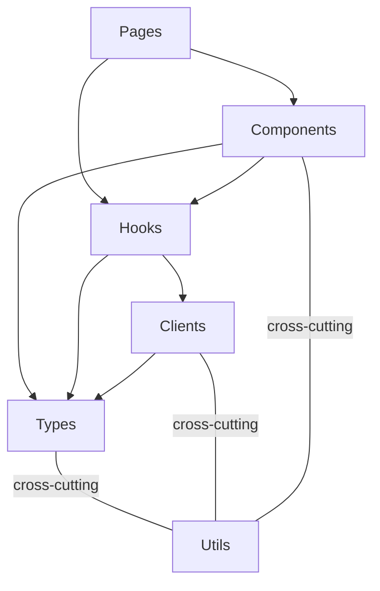

# Architecture — func-console

## Stack

React + TypeScript + PatternFly 6 + OCP Dynamic Plugin SDK

## Layered Architecture

Arrows mean "imports / depends on."

| Layer | Maps to | Depends on |
|-------|---------|------------|
| **Types** | `common/types.ts`, `pages/<name>/types.ts` | nothing |
| **Clients** | `common/clients/` (plain async functions) | Types, Utils |
| **Hooks** | Inlined in page/component files. Extract to `pages/<name>/hooks/` or `common/hooks/` only when reused. | Clients, Types, Utils |
| **Components** | `common/components/` (shared), `pages/<name>/components/` (page-specific) | Hooks, Types, Utils |
| **Pages** | `pages/<name>/` | Components, Hooks, Utils, Types |
| **Utils** | `common/utils/` | nothing (cross-cutting) |

### Dependency Rules

- Unidirectional: Types <- Clients <- Hooks <- Components <- Pages
- Utils can be imported by any layer
- Pages and components may import clients and hooks directly
- Clients/hooks never import Components or Pages
- No circular dependencies

### Co-location Convention

- `src/pages/<name>/` contains the page component, its test, and a `components/` subdir
- `src/pages/<name>/components/` contains components used only by that page
- `src/common/` contains everything shared across pages (components, clients, utils, context)
- `src/common/types.ts` contains shared wire/DTO types (backend response shapes) and pure functions that derive from those types. Used across pages. No React, no side effects, no imports from components or hooks.
- `src/pages/<name>/types.ts` contains types and pure functions that derive from those types. Used only within that page's directory. No React, no side effects, no imports from components or hooks.
- **Ownership rule:** pages are divided into sections which are extracted into components in `pages/<name>/components/`. Components that have sub-components keep them in the same file unless they can be reused, in which case they are extracted to their own file. Components shared across multiple pages live in `common/components/`.

## React

### Pages

- **Smart for page-specific data** -- pages use clients in their page hooks to fetch, prepare, and transform all data needed for downstream components. If multiple pages need the same data, extract a shared hook into `common/hooks/`.

### Components

- **Simple by default** — they receive data via props, render it, and call callbacks. No logic at the top of a component.
- **May own data when self-contained** -- a component may own its own data and state when it encapsulates a self-contained capability that is not specific to any one page (e.g., auth flows, notification subscriptions). Such components may use hooks directly. The component becomes the single owner of that concern. Pages consume it without orchestrating its internals.
- **Sub-components** — if a sub-component is only used by one parent, keep it in the parent's file, unexported. Extract to its own file only when the sub-component is used by multiple siblings.

### Clients

`common/clients/` contains thin wrappers around external APIs. Two forms:

- **`httpClient.ts`** -- the single fetch boundary. Wraps the SDK's `consoleFetch`/`consoleFetchJSON` with 401 -> `AUTH_EXPIRED_EVENT` dispatch and header flattening. All HTTP clients import `customFetch`/`customFetchJSON` from here, never from the SDK directly.
- **Plain async functions** (e.g., `functionsClient.ts`, `authClient.ts`) -- stateless fetch wrappers and SSE stream consumers that hooks call, built on `httpClient`.

### Hooks

- **Extract logic into hooks** — if a page or component has non-trivial logic (state management, data transformation, side effects), extract it into a custom hook. One-liner logic stays inlined in the component, no hook needed. If the hook is only used by one component, keep it in the same file, do not export it. If the hook is reused by multiple components within one page, put it in `src/pages/<name>/hooks/`. If reused across pages, put it in `src/common/hooks/`. Keep the translation hook (`useTranslation`) at the top of the page component, not inside custom hooks.

### Utility Functions

- **Same co-location rule as hooks** — if a utility function is only used by one component or hook, keep it in the same file, do not export it. If it is reused by multiple files within one page, put it in `src/pages/<name>/utils/`. If reused across pages, put it in `src/common/utils/`.

### File Ordering

Within a file, put the exported component at the top, then its hook below, then sub-components, then helper functions at the bottom. Readers see the main thing first and can drill down.

### Performance

- **No speculative memoization**: Do not wrap every function in `useCallback` or every value in `useMemo` as a habit. Use them when there is a concrete reason: a `React.memo` child that depends on a stable reference, or a known re-render path (e.g., a sibling component re-rendering on every keystroke). Plain functions and derived values are the default.

## Architectural Guidance

- PatternFly components preferred over custom HTML
- PatternFly styling and styling rules over custom CSS
- Error handling through ErrorProvider/addError pattern
- Shared utilities in `common/utils/`, not hand-rolled per component
- Clients consumed through hooks, never imported directly

---

## Backend (Go)

### Stack

Go + `net/http` standard library. Key dependencies:

| Dependency | Role |
|---|---|
| `k8s.io/client-go` | Kubernetes API client (SA, RBAC, TokenRequest, kubeconfig) |
| `google/go-github/v90` | GitHub API client |
| `knative.dev/func` | Function scaffold generation |
| `onsi/ginkgo` + `onsi/gomega` | Test framework |

### Packages

| Package | Responsibility |
|---|---|
| `kube` | Shared Kubernetes connection: builds a `*rest.Config` from host/token/caCert (or in-cluster), including the JSON content config and the default request timeout |
| `cluster` | Kubernetes provisioning: service account, RBAC provisioning, TokenRequest, kubeconfig generation; per-namespace existence checks |
| `functions` | Function lifecycle via knative/func: cluster queries behind the growable `functions.Client` facade (lists today), plus source/CI scaffold generation (`Generate`) |
| `handler` | HTTP handlers: input validation, orchestration, error mapping |
| `scm` | SCM abstraction types (`Platform`, `Registry`, `Client`) and filesystem helpers |
| `scm/github` | go-github implementation of `scm.Client` |
| `scm/credentials` | SCM tokens (GitHub PAT today, OAuth later) stored as Secrets in the backend's own namespace, each bound to the `identity.User` that created it |
| `identity` | Who the caller is: turns the console-forwarded user token into an `identity.User` (username + UID) via `SelfSubjectReview` on every request |
| `config` | Runtime configuration, package-level wiring vars (`SCMRegistry`), constants, and service account token expiry parsing |
| `tlsreload` | Reloads the serving cert/key from disk on change (fsnotify plus a poll fallback), swapping an atomic `*tls.Certificate` via `GetCertificate` so rotated certs are served without a restart |

### Dependency Rules

- `handler` imports `cluster`, `functions`, `scm`, `config` — never the reverse
- `cluster` and `functions` both import `kube` for connection setup, and have no knowledge of each other
- `kube` imports only `k8s.io/client-go/rest`; it depends on no other backend package
- `cluster` is for provisioning and cluster introspection (write RBAC/SA, request tokens, check namespace existence); `functions` is for the function lifecycle (list and scaffold generation). Both talk to the cluster but answer different questions, so they stay separate rather than sharing one client interface
- `scm` has no knowledge of cluster or functions
- `functions` imports `scm` only for `scm.Platform` and `scm.FileEntry` types
- `config` is imported by `handler`, `functions`, and `main` only; it owns runtime configuration and package-level wiring
- `identity` is a leaf next to `kube`: it imports `kube` and nothing else from the backend. It is about OpenShift identity, not SCM, so it sits at the top level rather than under the package that happens to use it most
- `scm/credentials` imports `identity` because a stored token is meaningless without the user it belongs to, and it owns the `identity.Resolver`. `handler` hands it the raw bearer token and gets a credential back, so it never holds an `identity.User` and never mediates between the two. `handler` imports `identity` only for `ErrUnauthenticated`, which is an OpenShift concept and does not belong behind an SCM package
- `scm/credentials` sits under `scm` because that is what it stores tokens for, but it imports neither `scm` nor `cluster` nor anything HTTP. The handlers that store and read the token live in `handler`, which is what keeps it free of the SCM dependency it would otherwise need to verify a PAT. Callers name it `scmCredentials` rather than `credentials`, so the variable never reads as cluster credentials

### Key Decisions

**Cluster access is split by intent: `cluster` (provisioning and introspection) vs `functions` (function lifecycle)**
Both talk to the same API server but answer different questions, so they are separate packages rather than one god-client. `cluster` writes RBAC/service accounts, mints tokens, and checks namespace existence for repo function validation; `functions` owns the function lifecycle via knative/func. The shared connection logic lives in `kube.RESTConfig`, which both call, so host resolution, TLS, JSON content config, and the default request timeout are defined once. `kube` is a leaf (depends only on `client-go/rest`), which keeps it importable by any domain package without cycles — unlike `config`, the wiring layer, which is off-limits to domain packages.

**`functions` is the single knative/func facade, but splits offline scaffolding from cluster operations**
Everything that wraps `knative.dev/func` lives in this one package, so there is a single boundary around that dependency. Within it, two responsibilities are kept apart because they have different needs:

- `Generate` (`scaffold.go`) is **offline**: it scaffolds a new function's source and CI files into a temp dir and returns `scm.FileEntry` blobs to push to a repo. It never contacts the cluster and needs no REST config, so it is a plain package function, not a method on `Client`. It is called standalone from the create handler, before any cluster client exists.
- `functions.Client` (`client.go`) is the **cluster-connected** CRUD facade, built via `NewClient(host, token, caCert)` and holding a `*rest.Config`. It exposes `List` today; deploy/undeploy/describe are expected next, hence an interface rather than a bare `Lister`.

`Generate` is deliberately not folded into `Client`: it would ignore the receiver's config entirely, and callers that only scaffold (the create handler) would be forced to build a cluster client with a host and tokens they do not need. Scaffolding produces repo source, not a cluster resource; the cluster-level "create" (deploy) will land on `Client` when it arrives.

**Cluster host resolution: explicit parameter via `--kube-host` flag**
`cluster.New(host, token, caCert)` and `functions.NewClient(...)` accept the API server URL as an explicit parameter and pass it to `kube.RESTConfig`. Empty host triggers `rest.InClusterConfig()` (production pods). In dev, `hack/dev.sh` passes `--kube-host $KUBE_API_SERVER` to the backend binary; in tests, it is passed directly. Env var injection (`KUBERNETES_SERVICE_HOST`) was explicitly rejected as it abuses a Kubernetes-standardized variable and creates hidden ambient state.

**External API URL resolved at Helm install time**
The URL embedded in generated kubeconfigs (`externalAPIServerURL`) comes from the Infrastructure CR (`config.openshift.io/v1/Infrastructure/cluster`) via Helm `lookup` at install time, injected as `--external-api-server-url`. It is not fetched at runtime. This eliminates the need for a `ClusterRole` to query the Infrastructure CR from within the pod.

**Deployment credentials are short-lived and refreshed before file updates**
The backend requests service account tokens with a configurable lifetime, set by `--sa-token-expiry` and defaulting to seven days. When a function is created, its kubeconfig is stored as the `KUBECONFIG` SCM secret and the token expiration timestamp is stored as the `KUBECONFIG_EXPIRE_AT` SCM variable. Before pushing edited files, the handler refreshes both values when the token has 24 hours or less remaining. Missing or malformed expiration metadata also triggers a refresh. Refresh uses the caller's OCP bearer token and the namespace from the repository's `func.yaml`; no cluster credentials are retained by the backend.

**TLS serving certificate reloaded at runtime by an fsnotify + poll hybrid**
The OCP service CA operator rotates the serving cert/key automatically. `tlsreload.Reloader` watches the mounted pair with fsnotify and atomically swaps the cached `*tls.Certificate` served via `tls.Config.GetCertificate`, so a rotation is picked up without restarting the pod. A poll ticker running every 30 seconds operates alongside the watcher as a safety net for events fsnotify can miss, in particular the atomic `..data` symlink swap Kubernetes uses for mounted secrets: when a watched file is removed or renamed the watch is re-added to the new file, and the poll guarantees the change is eventually observed regardless. Polling stays active during watcher setup failures and the 3-second watcher restart delays. Watcher events and poll ticks are processed on one goroutine, so `reload` and its content hash remain serialized and the swap needs only a plain atomic `Store` (no mutex). fsnotify was promoted from an existing indirect dependency; the heavier `k8s.io/apiserver/dynamiccertificates` and `controller-runtime/certwatcher` (which pulls in Prometheus) were avoided. Reloads are content-hashed to skip re-parsing when the pair is unchanged, and the last valid pair is retained when an update is incomplete or invalid.

**Credentials are stored per OpenShift user and found by identity, not by token**

A user's SCM credential lives in one Secret named after a SHA-256 of their identity (the UID where they have one, the username otherwise, prefixed so the two cannot collide). The name is hashed because it is not a secret: it shows up in audit logs and in `oc get secrets` for anyone with read access to the namespace. Connecting again overwrites that Secret rather than adding another, so a user never accumulates live PATs nobody deletes, and revocation has exactly one thing to delete.

`credentials.Store` takes the console's bearer token and resolves it itself, so a caller cannot reach a credential without having proved whose it is. The binding written into the Secret is verified on every read rather than inferred from where the Secret was found, since a deleted and recreated account could hash to the same name. HTTP handlers depend on `credentials.Provider`, implemented by `Store`, and tests inject a local `MapProvider` or `ProviderStub`; identity binding and expiry remain covered by the store tests over `k8s.io/client-go/kubernetes/fake`.

`WorkflowRunWatch` remains a standalone handler constructor with its own watch options. `WithCredentialsProvider` injects its read-only `handler.CredentialProvider` interface, which both `credentials.Store` and the test providers implement. It opens the SSE response before resolving the caller's credential, so missing or rejected caller credentials produce a 401 `app-error` frame and store failures produce a 503 frame, all within HTTP 200 responses.

The function routes and the credential GET route sit on a protected sub-mux that `newMux` (`backend/main.go`) mounts under `/api/v1/` behind `handler.RequireCredential`. The middleware validates the bearer header, resolves the stored credential once, and puts it, together with the caller's OpenShift token, into request context as a `requestCredential`; protected handlers read that back with `credentialFrom` rather than repeating authentication or storage lookups. The status mapping is unchanged from when each handler resolved its own credential: a missing credential is 401 on function routes but 404 on the credential GET, the route that reports whether a connection exists rather than assuming one, a rejected caller token is 401, and a store failure is 503. Health, static files, credential POST/DELETE, and workflow SSE stay outside the middleware: connecting and disconnecting must work for a caller with nothing stored, and the SSE handler already frames its failures inside the stream.

**The OpenShift identity is the only key, so there is no second token**

An earlier design issued a plugin session token alongside the credential. It was removed because it never was a second secret: the endpoint that re-issued it authenticated with the OpenShift token alone, so reaching the console proxy as a given user already yielded their SCM-backed session. What the token did buy was cost: a second TTL, a reissue path, a browser handle to lose, and a 401-resume-retry loop to recover it. Dropping it leaves the property that actually mattered intact, because it never came from the token: the credential is bound to an OpenShift identity, a caller who is somebody else cannot read it, and the PAT is never in the browser.

The consequence worth stating plainly is unchanged. Anyone who can reach the console proxy as a given OpenShift user can act with that user's stored SCM credential. That is the same exposure the console itself has, and it is the price of not making the user paste their PAT into every new tab.

**One TTL, and a 401 that means one thing**

`credentialTTL` (7d) is absolute and not sliding: it caps how long a stored credential can be used before the user supplies it again. Credentials past it are dropped when their owner next comes back (`dropSecretIfExpired`). There is no background sweep and writes are last-write-wins, so a credential whose owner never returns stays until its Secret is removed by other means, and concurrent writes to one user's Secret resolve by whoever lands last. Both are deliberate for a tech preview.

The credential is one resource with three verbs:

- `POST /api/v1/scm/github/credential` verifies the PAT with the SCM provider **before** writing it, so a token that cannot work never overwrites one that still does. It answers 201 with the SCM login and avatar, never the token, and **403** when the provider rejects what was supplied.
- `GET /api/v1/scm/github/credential` answers 200 with the connected account, or **404** when the user has nothing stored. Not 401: the frontend reads 404 as "ask for a PAT" and 401 as an authentication failure, and conflating them would prompt on a backend blip. A 503 says the store could not be read, which is not the same as there being nothing in it.
The caller's SCM credential is one resource with three verbs, named for what it is rather than for the token inside it: `GET` answers with the account the credential belongs to, which is its only representation that is safe to return. The provider sits in the path so a second one can be added beside it; it is the literal `github` until there is a second, rather than a parameter the backend would accept and ignore.

- `DELETE /api/v1/scm/github/credential` is keyed on the OpenShift user. A leaked anything must not be a way to revoke somebody else's connection, and the browser disconnects regardless of whether the call succeeds. The backend Role needs `update` on secrets alongside `create`, `get`, and `delete`, because reconnecting overwrites the Secret in place.

`writeAuthError` is the only source of 401, which is what lets the frontend read that one status as "connect to GitHub": either the OpenShift identity could not be established, or the store holds no credential for it. That has to hold everywhere, because `customFetch` turns any 401 into `AUTH_EXPIRED_EVENT` and disconnects. An SCM provider rejecting a token is a **403**, whether the token was stored earlier or supplied on the request being served: re-asking for the OpenShift identity cannot repair either, and answering 401 for a mistyped PAT would throw away a working connection.

The frontend holds no auth state of its own. `AuthProvider` calls `GET /api/v1/scm/github/credential` on mount, and renders a spinner rather than its children until the answer arrives, so a user whose PAT is already stored is connected having typed nothing and nothing below ever has to reason about "not connected yet". `customFetch` does not retry: a 401 fires `AUTH_EXPIRED_EVENT` and `AuthProvider` clears its state. That is why a rejected PAT is a 403 and not a 401, which would disconnect a user over a typo.

Credentials past `credentialTTL` are dropped when their owner next comes back (`dropSecretIfExpired`). There is no background sweep and writes are last-write-wins, so a credential whose owner never returns stays until its Secret is removed by other means, and concurrent writes to one user's Secret resolve by whoever lands last. Both are deliberate for a tech preview.

The identity comes from the console proxy, which is declared `authorization: UserToken` and forwards the console user's bearer token in `Authorization`. That token is opaque, so `identity.Resolver` asks the API server who it belongs to with a `SelfSubjectReview` (the call behind `oc auth whoami`), which every authenticated user may create; reading `users.user.openshift.io` would need a `ClusterRole` the backend does not have. Every credential save, read, and delete repeats this check, so a token rejected by the API server cannot continue reaching stored SCM credentials through a cached identity. The Secret is accessed with the backend's own ServiceAccount, which cannot establish whether the caller's console token is still valid on its own.

`identity.User` carries both the username and the UID. The UID is the authoritative key where it exists, since a username can be deleted and recreated for a different person while a UID is never reused, but `kube:admin` is backed by a static Secret rather than a `User` object and has none, so `Matches` compares both and falls back to the name alone when neither side has a UID. Two empty users never match, which keeps a credential written without a binding from being readable by everybody.

**SCM is abstracted behind a registry**
`scm.Registry` maps `scm.Platform` → `scm.ClientFactory`. The active registry lives at `config.SCMRegistry`, a package-level var that tests swap out via `withSCMMock`. Handlers never reference a concrete SCM client type. The platform is currently resolved statically (`scm.DefaultPlatform = GitHub`), but the registry is designed to support dynamic platform selection — the handler can later derive the platform from the request body or header without changes to the registry or client implementations.

**Repo function namespace validation uses `Get` per namespace, not `List` all namespaces**
When `listRepoFunctions` collects repo-backed functions, it validates each function's namespace against the cluster using `cluster.Client.CheckNamespace`, which calls `CoreV1().Namespaces().Get(ctx, namespace, ...)`. Three outcomes are possible:

- **404 Not Found** (`cluster.ErrNamespaceNotFound`): namespace is confirmed absent. The function is shown with `err: "func.yaml: namespace does not exist"`.
- **403 Forbidden** (`cluster.ErrNamespaceForbidden`): namespace exists but the caller's OCP token cannot access it. The function is shown with `err: "func.yaml: namespace access denied"` so the user can see it and request access.
- **Other error** (transient network or API failure): the function is shown with `err: "func.yaml: namespace check failed"` rather than being silently hidden or shown as NotDeployed.

Using `List` all namespaces and then checking membership was rejected: `Namespaces().List(...)` returns only namespaces visible to the caller's token, and regular OCP users typically lack the cluster-wide `list` verb. `Get` per namespace is used instead: it requires only the `get` verb scoped to the target namespace, and disambiguates 404 (genuinely absent) from 403 (exists, no access) — a distinction that `List` cannot make.

**Handler error mapping**
`createFunction` wraps upstream failures explicitly:

| Error | HTTP status |
|---|---|
| `scm.ErrUnauthorized` | 403 |
| `scm.ErrRepoExists` | 409 |
| `errUpstream` (cluster or SCM failure) | 502 |
| validation failure | 400 |
| internal error | 500 |

**Handlers are stateless**
`Handlers` holds only static configuration, including the requested service account token lifetime. Cluster clients are request-scoped, authenticated with the caller's OCP bearer token, and created only when an operation needs cluster access. There is no shared connection or credential.
