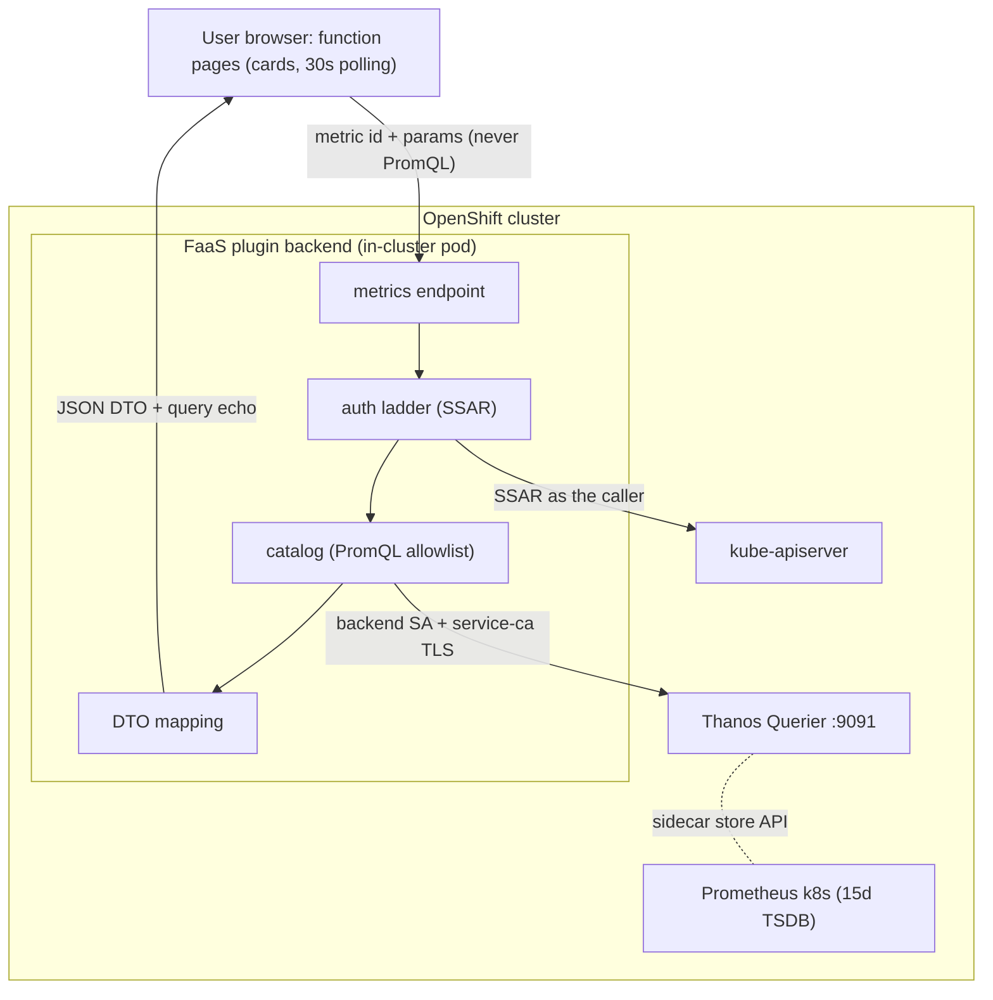

# SRVOCF-1173: Monitoring PoC

- **Date:** 2026-11-16
- **Jira:** SRVOCF-1173 (spike)
- **Purpose:** Settle the implementation choices the spike investigated, and collect the open points that need a team decision before implementation tickets are created.
- **PoC Branch:** `SRVOCF-1168-monitoring-poc`

## TL;DR: pinned decisions

| Decision | Choice |
|---|---|
| Query endpoint | `GET /api/v1/monitoring/metrics`, metric id + selection params, no PromQL from frontend |
| Thanos access | Backend queries the web port (`:9091`) with its own ServiceAccount |
| Per-user authorization | SelfSubjectAccessReview gate in the backend before every query |
| Thanos flags | `--thanos-url` and `--thanos-ca-path` both mandatory; TLS verification cannot be skipped |
| DTO | JSON with explicit states: `data` / `no-data` / `error`; real zero is data, not no-data |
| Polling | Frontend polls every 30s by default (15s-5m selectable); sequential, non-overlapping batches |
| Backend libs | `prometheus/client_golang` v1.25.0 + `prometheus/common` v0.72.0 |
| Frontend libs | `@patternfly/react-charts` v8 + `victory` v37 (umbrella package) |
| Range cap | 14 days (matches the longest UI selector; platform retention is 15d) |

## 1. Prototype location

- Branch: `SRVOCF-1168-monitoring-poc`
- Backend:
  - [backend/monitoring/](../../backend/monitoring/) - client, catalog, result mapping, authz
  - [handler/monitoring.go](../../backend/handler/monitoring.go) - endpoint
  - [main.go](../../backend/main.go) - wiring
- Frontend:
  - [MetricCard.tsx](../../src/common/components/MetricCard.tsx), [MetricsToolbar.tsx](../../src/common/components/MetricsToolbar.tsx)
  - [src/common/monitoring/](../../src/common/monitoring/) - polling hook, types
  - [monitoringClient.ts](../../src/common/clients/monitoringClient.ts)
- Surfaces: [MetricsDrawer.tsx](../../src/pages/function-list/components/MetricsDrawer.tsx) (list page bottom sheet), [FunctionDetailPage.tsx](../../src/pages/function-detail/FunctionDetailPage.tsx) (new route)
- Seed data: [seed-monitoring.sh](../../hack/seed-monitoring.sh)

## 2. Libraries used

Backend:

| Library | Version | Role |
|---|---|---|
| `github.com/prometheus/client_golang` | v1.25.0 | Thanos HTTP API client (`api`, `api/prometheus/v1`) |
| `github.com/prometheus/common` | v0.72.0 | `model.Matrix` / sample types for parsing responses |
| `k8s.io/client-go` | v0.36.5 | SSAR, SelfSubjectReview, namespace listing |

Frontend:

| Library | Version | Role |
|---|---|---|
| `@patternfly/react-charts` | v8 | Chart wrappers with PatternFly theming (imported via the `react-charts/victory` subpath) |
| `victory` | v37.3.6 | Umbrella package satisfying react-charts' peer dependencies; also imported directly for sparkline internals (`VictoryClipContainer`, `Curve`) |


## 3. Other plugins' libraries considered

Reference implementation studied: openshift/monitoring-plugin (the console's own Observe section).

| Library | What it gives | Our verdict |
|---|---|---|
| `@tanstack/react-query` | Declarative polling, caching, dedup, retries | Not adopted; our 205-line `useMetricsPolling` covers current needs. Adopt when: cached data must survive navigation, metrics appear in multiple views at once, or retry/reconnect logic is needed |
| `@perses-dev/{dashboards,components}` | Full dashboard engine (panels, PromQL editor, time controls) | Not adopted for curated cards. Strategic option if requirements move to user-configurable dashboards; can be embedded frontend-only with our backend as the Prometheus-compatible datasource, keeping authz server-side |
| `@openshift-console/dynamic-plugin-sdk-internal` | Extra console components | Rejected: no compatibility promise, public SDK covers our needs |
| `prometheus-operator/pkg/client` | Typed ServiceMonitor/PrometheusRule clients | Future: when functions get their own alerting/scrape rules |
| `openshift/library-go` `crypto.SecureTLSConfig` | Platform-standard TLS hardening | Candidate for the real implementation; skipped for the PoC to stay lean |

Architecture comparison with monitoring-plugin (informed several decisions below):

- Their model: thin reverse proxy, forwards the user's token to Thanos. Suits bring-your-own-query dashboards.
- Our model: aggregation backend querying with our own ServiceAccount. Suits curated per-function views with a controlled metric surface - and it is unit-testable (query and authz decisions are plain functions).

## 4. Backend architecture decisions and why

Context primer - the OpenShift monitoring stack, and where Thanos fits:

- **Prometheus** (the `k8s` instance in `openshift-monitoring`): the scraper and time-series database. Collects from scrape targets every ~30s, stores locally, 15d retention by default.
- **HA pair**: on full clusters, two Prometheus replicas scrape the same targets; each has a **Thanos sidecar** exposing its data store over gRPC.
- **Thanos Querier**: sits in front of the pair. Fans queries out to both sidecars, **deduplicates the identical series** the HA replicas produce, serves one consistent cluster-wide query endpoint.
- **Object storage + store gateway** (optional): extends history beyond local retention. Not configured by default on clusters.

Why we query the Thanos Querier rather than a Prometheus replica directly:

- it is the interface the CMO supports for cluster-wide queries - the console itself goes through it
- on HA clusters it deduplicates the replica pair; a direct replica query returns one replica's view
- the RBAC layering we rely on (`kube-rbac-proxy` web/tenancy ports, `cluster-monitoring-view`) is implemented at the Querier, not at Prometheus

The request path in one picture:




### 4.1 Rejected alternatives

**SSE / watcher delivery for metrics:**

- watches are for events; metrics are scheduled ~30s samples - there is nothing to be instant about
- the gain would be at most ~30s, invisible on charts aggregating 5m windows - and Thanos has no streaming query API, so the backend would poll and re-push anyway
- the console's own monitoring pages poll; SSE would be a delivery mechanism OpenShift monitoring does not use anywhere

**Console SDK integration (`QueryBrowser`, `usePrometheusPoll`):**

- `QueryBrowser` is a PromQL-input component - it puts query construction in the frontend, against the catalog allowlist
- the plugin is moving SDK usage to the backend; this spike follows that direction

### 4.2 Backend-mediated queries (not token forwarding)

The frontend never sends PromQL or backend URLs - only a metric id plus selection parameters. The backend:

1. validates the metric id against a catalog (allowlist)
2. authorizes the caller (SSAR)
3. builds the PromQL itself
4. queries Thanos with the backend's own identity
5. maps the result into a DTO with an explicit state

Why:

- every decision (what is queryable, who may see it) lives in one testable place
- the frontend stays Prometheus-oblivious
- the query surface is an allowlist by construction, not a sanitizer

### 4.3 Web port 9091, not the tenancy port 9092

The Querier serves two query ports with different access models:

| | Web `:9091` | Tenancy `:9092` |
|---|---|---|
| Authorization | cluster-wide `cluster-monitoring-view` | every request must name one namespace, and the caller must have read access to it |
| Query rewriting | none | pins `namespace="<X>"` into every query |
| Reach | any namespace, cluster-wide, multi-namespace | exactly one namespace per request |
| Audience | admins and monitoring tooling | namespace-scoped users |

Why 9091:

- **9092 cannot serve our metrics**: Knative control-plane series carry the tenant in `namespace_name`, but their `namespace` label is `knative-serving` - the tenancy port's forced matcher selects nothing for them
- **one gate, ours**: per-user authorization is the backend's SSAR ladder, not the proxy's forced matcher
- **the overview**: all-namespaces and readable-slice queries need the cluster view - structurally impossible on 9092

Why 9091 stays right even after KEDA (which restores tenancy-port compatibility):

- the all-namespaces overview would need one query per readable namespace (each authorized separately, then merged client-side) - 9091 serves it as a single query
- on 9091, filtering is whatever the catalog's PromQL chooses (any label); on 9092 the port itself filters by the `namespace` label - every future metric source would have to carry the tenant in exactly that label
- 9092 has no external route (dev would need port-forwarding)

### 4.4 The authorization ladder

For every request (handler `buildSelector` in [monitoring.go](../../backend/handler/monitoring.go)):

1. Namespace-scoped query: SSAR "can get pods in namespace X". Denied -> 403.
2. All-namespaces query: SSAR cluster-scoped. Allowed -> unscoped query.
3. Not cluster-wide: list the caller's readable namespaces (the namespace list is RBAC-filtered by the API server) and inject `namespace_name=~"ns-a|ns-b|..."`. Empty set -> 403.

Notes:

- the check is `get pods` in the namespace - a strong proxy for "can see workloads there", evaluated as the caller's own identity, no elevated backend privilege
- open point: should the implementation require a monitoring-specific verb instead? (see open questions)
- code placement: authz functions live in [authz.go](../../backend/monitoring/authz.go)

### 4.5 Token and TLS handling

- Token rotation: the projected ServiceAccount token is refreshed by the kubelet roughly every 48 minutes (80% of its ~1h validity), so a startup snapshot would die within about an hour. Client-go clients pick this up natively, but the Thanos client is `prometheus/client_golang`, not client-go - hence `TokenSourceFromConfig` + the bearer-injecting RoundTripper in [client.go](../../backend/monitoring/client.go) re-read the token file per request
- TLS verification is mandatory:
  - `--thanos-ca-path` required
  - in-cluster: the Thanos service cert is signed by the service-signing CA, a different CA from the kube-apiserver one every pod has by default (`serviceaccount/ca.crt` verifies only the API server) - hence the injected service-ca bundle
  - dev: ingress CA published in the `default-ingress-cert` ConfigMap

### 4.6 The metric catalog

A catalog entry - the `Descriptor` in [catalog.go](../../backend/monitoring/catalog.go) - has four fields:

| Field | Meaning |
|---|---|
| `ID` | the metric id the frontend requests |
| `Scope` | the level the metric is defined at: `namespace` (aggregated over the selected namespaces - one, many, or all; no specific function required) or `function` (requires exactly one function) |
| `Unit` | display unit (req/s, bytes, count...) |
| `BuildRangeQuery` | turns the authorized selector into the PromQL |

How `Scope` couples into the request pipeline:

1. it sets the parameter contract: function-scoped metrics require `namespace` + `function` (400 otherwise); namespace-scoped metrics may omit the namespace
2. ...

For the PoC we chose three existing entries, deliberately spanning two sources, three scoping schemes, and two namespace semantics - to prove the extensibility mechanism:

| id | Scope | Unit | Source | Namespace semantics |
|---|---|---|---|---|
| `request-rate` | namespace | req/s | `activator_request_count` (Knative control plane) | `namespace_name` |
| `pod-scaling` | function | (count) | `autoscaler_actual_pods` (Knative control plane) | `namespace_name` |
| `memory-usage` | function | bytes | `container_memory_working_set_bytes` joined to `kube_pod_labels` on `label_function_knative_dev_name` | standard `namespace` |

- Adding a chart = a catalog entry plus a frontend card reference. No new endpoint.

## 5. Wire contract (DTOs and data models)

### 5.1 Request

`GET /api/v1/monitoring/metrics` (handler: [monitoring.go](../../backend/handler/monitoring.go))

| Param | Required | Meaning |
|---|---|---|
| `metric` | yes | catalog id; unknown ids are 400 |
| `namespace` | no | absent means all-namespaces (the auth ladder applies) |
| `function` | for function-scoped metrics | 400 when missing |
| `start`, `end` | yes | Unix seconds; range clamped to 14d |
| `step` | yes | the interval between returned points - one point per step (viewing resolution). Seconds; min 5s, raised if the range would exceed 1500 points (see section 8) |

### 5.2 Response

```jsonc
{
  "state": "data",            // data | no-data | error
  "metric": "request-rate",
  "unit": "req/s",
  "query": "sum by (...)(...)", // exact authorized PromQL, echoed for the
                                // "View in Metrics" redirect
  "canViewInMetrics": true,     // caller could re-run this query as themselves
  "series": [{ "name": "ns/fn", "points": [{ "t": 1760000000, "v": 1.25 }] }],
  "asOf": 1760000123,           // newest sample timestamp, seconds
  "message": "..."              // error/no-data explanation
}
```

(DTO definition: [types.go](../../backend/monitoring/types.go); matrix-to-DTO mapping: [result.go](../../backend/monitoring/result.go))

State semantics (a design anti-goal made them explicit):

- a real `0` is `data` (a scaled-to-zero function genuinely has zero pods)
- `no-data`: query succeeded, no series
- `error`: upstream failure, timeout, or authorization denial

Frontend polling behavior ([useMetricsPolling.ts](../../src/common/monitoring/useMetricsPolling.ts)):

- query keys are `metric:namespace:function`, deduplicated per poll cycle
- all cards of a view batch into one sequential cycle (non-overlapping)
- polling pauses on hidden tabs

### 5.3 Series naming

Derived in `seriesName` ([result.go](../../backend/monitoring/result.go)):

- multi-namespace charts: `namespace_name/service_name`
- single-namespace: `service_name`

## 6. External configuration

Backend flags (both mandatory; the process refuses to start without them):

| Flag | Value |
|---|---|
| `--thanos-url` | Thanos querier base URL, e.g. `https://thanos-querier.openshift-monitoring.svc:9091` |
| `--thanos-ca-path` | CA bundle for TLS verification |

New chart objects:

- [monitoring-service-ca.yaml](../../charts/openshift-console-plugin/templates/monitoring-service-ca.yaml) - ConfigMap with `service.beta.openshift.io/inject-cabundle: "true"`; the service-ca operator injects and rotates the bundle
- [monitoring-clusterrolebinding.yaml](../../charts/openshift-console-plugin/templates/monitoring-clusterrolebinding.yaml) - binds the plugin ServiceAccount to the built-in `cluster-monitoring-view` ClusterRole

## 7. Dev mode vs production

| | Dev ([dev.sh](../../hack/dev.sh)) | Production (chart/operator) |
|---|---|---|
| Thanos endpoint | external route (`https://thanos-querier-...apps-crc.testing`) | in-cluster service (`...svc:9091`) |
| Identity | dev user's kubeconfig token | plugin ServiceAccount |
| TLS CA | ingress CA fetched at startup from the `default-ingress-cert` ConfigMap (refetched every start, so CA rotation is picked up) | service-ca bundle from the injected ConfigMap ||
| Console | off-cluster bridge container; our plugin + the cluster monitoring plugin registered via `BRIDGE_PLUGINS`, the latter reached through an `oc port-forward` (the container cannot resolve `.svc` DNS - the forward is the standard bridge for that network boundary) | in-cluster console |

Dev-script notes:

- Thanos route lookup is mandatory - dev fails fast with an explanatory message if the cluster has no cluster monitoring
- the console container gets `BRIDGE_K8S_MODE_OFF_CLUSTER_THANOS` so the Observe section works next to our pages for comparison

## 8. Limits, ranges, and why

| Limit | Value | Set by | Rationale |
|---|---|---|---|
| Query range | 14 days max | backend (hard clamp) | longest UI selector; prometheus retention is 15d |
| Selectable ranges | 5m, 15m, 30m, 1h, 2h, 6h, 12h, 1d, 2d, 1w, 2w | frontend | toolbar dropdown; 1 hour is the default view |
| Points per query | 500 (design) / 1500 (hard) | frontend / backend | chart resolution vs payload; backend cap protects direct API callers |
| Minimum step | 5s | both | below the ~30s scrape interval, points only interpolate; matches the console's shortest-view density |
| Query timeout | 30s | backend | per-query context deadline |
| Refresh interval | 30s default; 15s/30s/1m/5m/off | frontend | console goes until 1d - doesn't make sense for us |

### How points per range are calculated

Definitions:

- **Step**: the time interval that collapses into a single returned data point. It is the *viewing resolution*, not the data's - raw samples arrive at each target's own scrape interval (30s for the Knative control-plane metrics, 1m for the kubelet-sourced memory), only when a scrape succeeds, with no alignment between targets; the step decides how many of those each point summarizes.
- **Point**: one `(timestamp, value)` pair in the response.
- **500 points (`POINT_LIMIT`)**: frontend-only design limit, aligned with Perses dashboards (maxDataPoints ~500) ([useMetricsPolling.ts](../../src/common/monitoring/useMetricsPolling.ts)) - a display-resolution choice, not an enforced constraint. The backend does not know it exists. It is decided by the frontend as it is the one displaying the points.
- **1500 points (`metricsMaxPoints`)**: backend hard limit ([handler/monitoring.go](../../backend/handler/monitoring.go)) - the only layer that enforces anything, applied to every caller including direct API requests. Why: every point is an expression evaluation on the shared Thanos Querier, and the response passes through the plugin pod (10m CPU / 50Mi requests) - an unbounded step (e.g. `step=1s` over 24h = 86,400 points) would degrade the platform querier and can OOM the pod. The limit bounds the *per-request* cost only: higher resolution stays available by chunking the time window, and 1500 is already ~3x what dashboard tooling requests.
- **5s minimum step** (`MIN_STEP_SECONDS` / `metricsMinStep`): enforced by both layers. Why a floor: below the scrape interval a point carries no new timing information - sub-scrape steps only interpolate. Without a floor, that interpolation is unbounded (a 20s zoom computes a 0.04s step). Why 5s: a cosmetic bound, not the information boundary (30s) - at the 5m view it yields 60 points, exactly the console page's density. We interpolate up to 6x, no further.

How a point is calculated when the step window holds multiple samples (by the PromQL engine at each evaluation instant):

- gauges: the **newest sample at or before the instant wins** - not the first, not an average - within a 5-minute lookback (Prometheus's fixed `lookback-delta` default, independent of step: how stale a value may be and still count as current); no sample in the window means no point (the idle-function no-data behavior)
- `rate()`: uses the **first and last** sample of its 5-minute window to compute the per-second increase - no single sample is picked

How the step value flows:

```
frontend computes it                backend guards it               Thanos evaluates it
step = max(5s, range/500)    →   min 5s; raise step if   →   one point per step interval,
(target: <=500 points/chart)     range/step > 1500            computed from the raw samples
```

Worked example, 24-hour view:

```
raw data:      ~2,880 samples per series (24h of scrapes) - never shipped
frontend step: max(5s, 86400/500) = 173s (~2.9 min)
query:         query_range(start, end, step=288s)
response:      ~500 points per series, each summarizing its 173s window
```

Direct API caller with `step=1s` over 24h:

- backend raises the step to `86400/1500 = 57.6s`
- caller gets ~1500 points, not 86,400 - and never the frontend's 500, because nothing server-side knows about it

Per range (what the UI actually sends):

| Range | Step | Points |
|---|---|---|
| 5 minutes | 5s (floor) | ~60 |
| 15 minutes | 5s (floor) | ~180 |
| 1 hour | 8s (rounded up) | ~450 |
| 6 hours | 44s (rounded up)  | ~490 |
| 24 hours | ~2.9 min | ~500 |
| 14 days | ~40 min | ~500 |


Spike visibility at long ranges (a known limitation, by design):

- at 500 points, a 24h view resolves ~2.9 min/point and 14d resolves ~40 min/point - short spikes are smoothed away. No realistic point budget fixes this: a 30s spike surviving at 24h would need ~2,880 points, and the 5-minute `rate()` window smooths it before the step ever does
- the intended drill-down is zoom (re-fetches the sub-range at the 5s floor); the intended spike *detector* is alerting on the raw data server-side, not chart resolution

## 9. Chart features

Live updates and window behavior:

- **Sliding window**: every poll cycle re-derives the query window (`end = now`, `start = end - range`). The x-axis slides forward, the line scrolls left, "now" stays pinned at the right edge - continuous movement without re-mounting the chart. The blank strip at the right edge (up to one step wide) stays roughly constant width.
- **Hidden tabs**: polling pauses while the tab is hidden, resumes on focus with a fresh window - returning to the tab jumps the chart forward to now rather than replaying the gap.
- **Manual refresh**: clears any zoom, triggers an immediate re-fetch with the sliding window.
- **Zoom freezes the window**: while zoomed, each poll re-fetches the exact zoom sub-range (fixed start/end) - the view is effectively frozen for inspection. Changing the time range or resetting zoom resumes the sliding window.

Interactions:

- Drag-to-zoom on any chart (pixel-to-domain overlay), shared zoom state per surface, "Reset zoom" in the toolbar
- Grouped tooltip: all series' values at the hovered timestamp
- Legend with color-pinned symbols (10-color scale, cycling beyond)
- One shared toolbar per surface (time range, refresh interval, manual refresh, reset zoom), styled after the console monitoring-dashboards dropdown pattern
- "View in Metrics" action per card:
  - deep-links to the console's `/monitoring/query-browser` with the exact authorized PromQL
  - shown only when `canViewInMetrics` is true (namespace-scoped queries, or genuinely cluster-wide callers)
- Overlapping lines: full-opacity lines with stroke headroom; the tooltip is the disambiguator

## 10. Views, queries, and routes

| Surface | Query | Auth path |
|---|---|---|
| List page drawer (`MetricsDrawer`, namespace mode) | `request-rate`, namespace-scoped | SSAR on the namespace |
| List page drawer, all-namespaces mode | `request-rate`, no namespace | ladder: cluster-wide or readable-namespaces regex |
| Function detail page | `pod-scaling` + `memory-usage`, function-scoped | SSAR on the namespace |

Routes ([console-extensions.json](../../console-extensions.json)): new function detail page at `/faas/functions/:namespace/:name`; function names in the list table link to it

## 11. Edge cases encountered

- **Memory series are per pod, and pods churn** - scale-down/up produces new series that are technically different pods of the same function:
  - the detail page deliberately renders all of them in a single color (`#0066CC`, `showSeriesNames=false`) to convey "these are the same function"
  - individual pod identity is not visually distinguishable
  - implementation should decide: keep per-pod series with unified color, aggregate to one series, or expose pod identity on hover
  - this may affect other metrics like `pod-scaling`
- **Real zero vs no-data**: scaled-to-zero functions show `v:0` on the scaling chart (data); an idle request-rate query returns no series (no-data). These render differently by design.
- **Clusters younger than the selected range**: the older portion of the window renders no-data (correct - the samples never existed).

## 12. Open questions for the team meeting

1. **Series cap** (limiting how many functions the overview chart shows):
   - Current position: no cap; the question is whether a graphical limitation exists
   - The real constraint is readability: the 10-color cycle makes series indistinguishable, and beyond a few dozen lines the chart cannot be read
   - Data volume is probably not the blocker: per-series payload is already bounded by the 500-point cap (~17 KB per series), so total cost only scales linearly with function count
   - If a limit is wanted: signaled truncation ("showing N of M") or server-side topk (the original plan called for `topk(N,...)`; not implemented)
2. **SSAR verb choice.** `get pods` is the working proxy for namespace visibility. Should the implementation check a monitoring-specific permission instead, so metric access does not implicitly follow pod-read access?
7. **Caching.** No server-side caching; each card polls independently through one shared batch per view. If the same metrics are requested by many concurrent users: short server-side TTL, or `@tanstack/react-query` on the client (see the library table for adoption triggers).

## 13. Needs for the real implementation

- Answer open questions
- Unit/Integration/E2E testing
- Define KEDA metrics catalog and replace the current one
- Load/metric generation for demos and tests: [seed-monitoring.sh](../../hack/seed-monitoring.sh) `--traffic` is a starting point; a proper load generator belongs with the test suite
- TLS hardening: consider `openshift/library-go` `crypto.SecureTLSConfig`
- i18n for card titles and toolbar labels (i18next namespace wiring)
